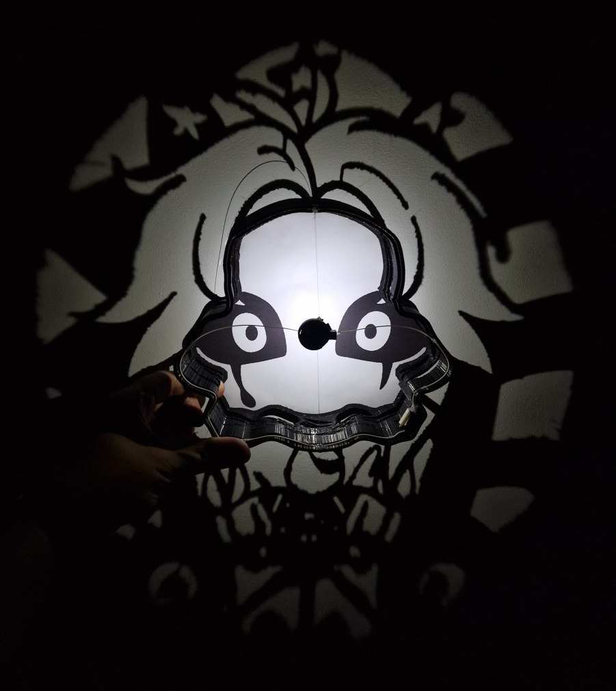
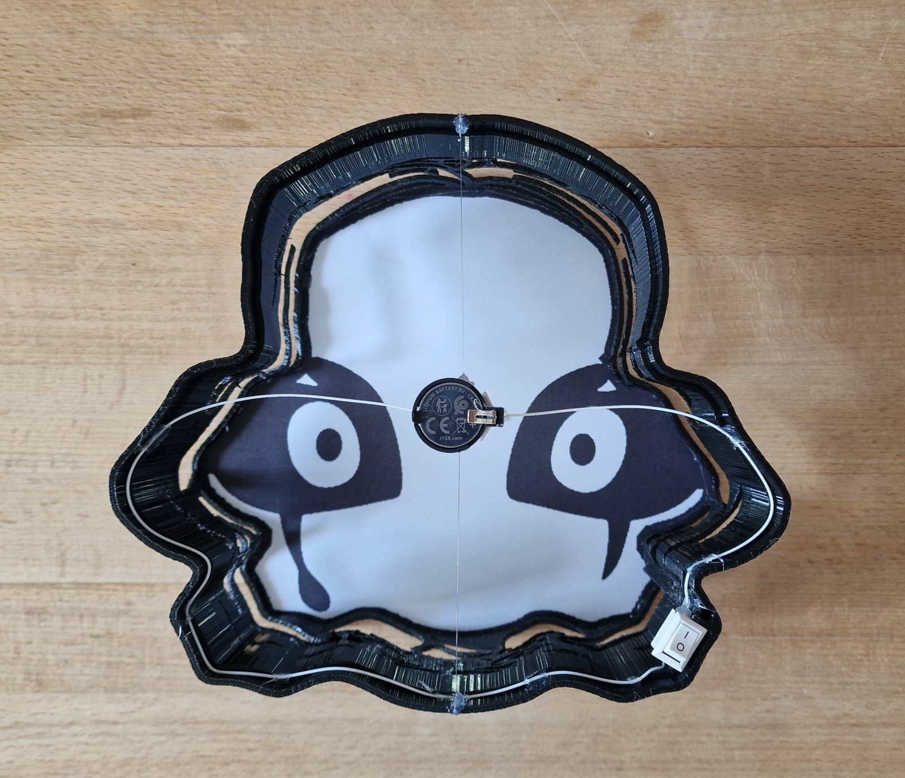
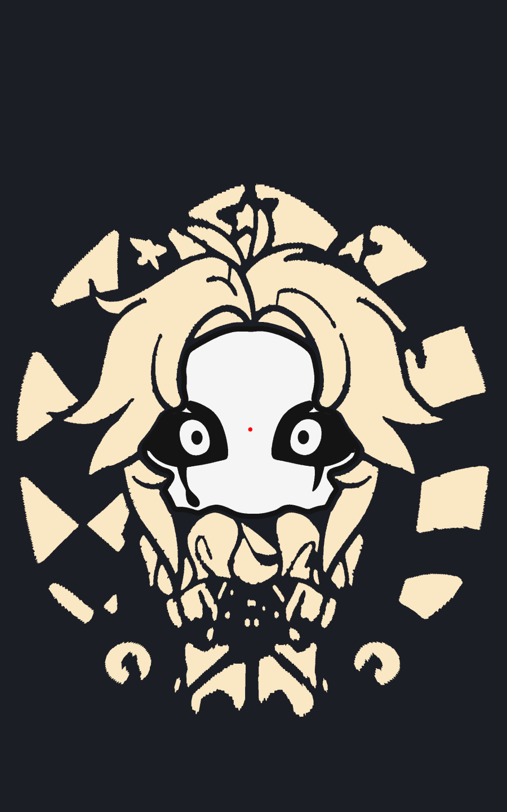
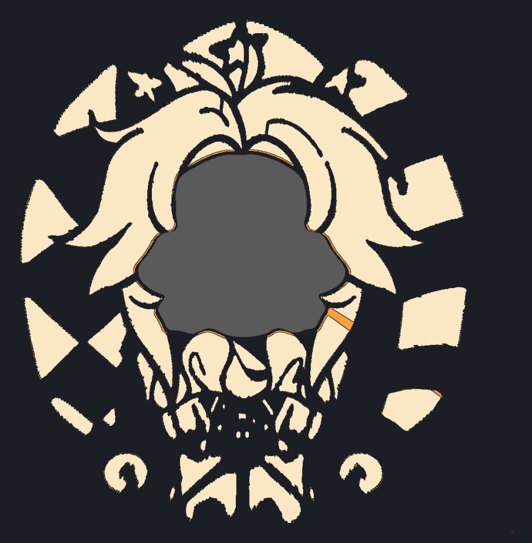
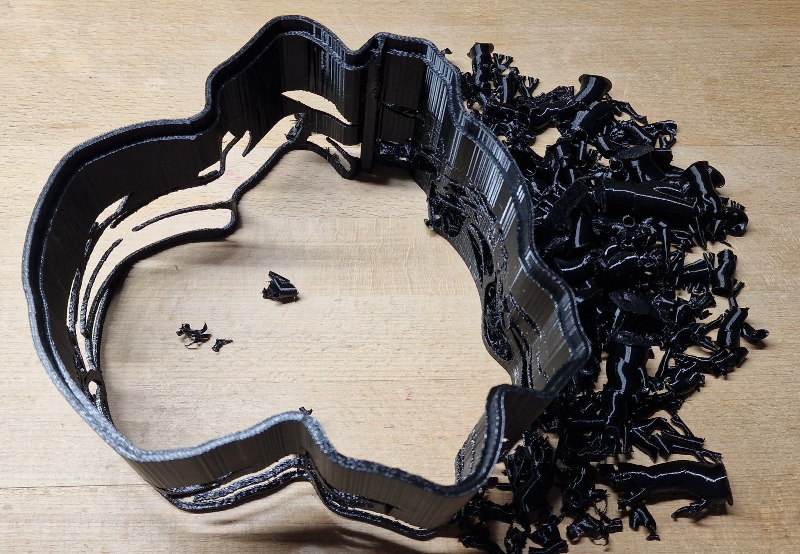

# Pierrot shadow lamp

**English** · [Українська](README.uk.md)

A 3D-printable night light that draws a character with light. The lamp
itself is a low box shaped like Pierrot's face. The face, with its black
outline and painted eyes, is the lid, and with the lamp off that is all you
see. Inside sits an LED. When it is on, light passes through shaped slots in
the walls and draws the rest of the character around the lamp: the hat, hair,
collar, body and bells.



The model is parametric (OpenSCAD), and the slots in the wall are not drawn
by hand: a script computes them from a black-and-white drawing. Every ray from
the LED to a light point of the drawing on the table crosses the wall, and
that is where the wall gets a hole. So the same approach works for another
character too.

## What you get

- A box of about **20.5 × 18 cm**, about **9 cm** tall with the lid.
- A light picture on the table of roughly **45 × 50 cm**.
- Prints without slicer supports: where supports are needed they are already
  part of the model and are snapped off afterwards.

| Assembled lamp, top view | Intended picture | Shadow computed from the finished wall |
|---|---|---|
|  |  |  |

## Quick start

There are no ready STLs in the repository — they are built from the model
with one command.

```sh
git clone <this-repository-url> shadow-lamp-pierrot
cd shadow-lamp-pierrot/versions/v003-print-support

python3 -m venv .venv
.venv/bin/pip install numpy opencv-python-headless trimesh

make build
```

`make build` picks up Python from the `.venv` next to it (or another one via
`make build PY=…`), renders every part into `out/` and checks them. At the end
you should see `open edges 0` for every part (the meshes are closed) and a
near-zero `stray light` (no light where there should be shadow).

What to print from `out/`:

| File | Part | Filament |
|---|---|---|
| `pierrot_shell_print.stl` | Wall with slots, including built-in supports | Matte black PLA, **opaque**; turn slicer supports off |
| `pierrot_ceiling.stl` | Ceiling with the LED socket | Same dark PLA |
| `pierrot_lid_2color.3mf` | Face lid in two colours (AMS / MMU) | White + black |
| `pierrot_lid.stl` | Single-colour lid for a single-colour printer | White; paint the black parts afterwards |
| `pierrot_pins.stl` | Three pins that hold the lid | Any |

After printing, the supports are snapped out of the wall with tweezers — you
end up with quite a pile:



Slicer settings (layer height, Arachne wall generator), the LED, wiring and
assembly are described in the
[v003 README](versions/v003-print-support/README.md) (in Ukrainian).

## Requirements

**To build the model**

- [OpenSCAD](https://openscad.org/) — a recent build (nightly / development
  snapshot), because the script renders with `--backend=manifold` and
  `--enable=lazy-union`. The old stable 2021.01 does not know these options.
- Python 3 with `numpy`, `opencv-python-headless`, `trimesh` (`trimesh` is
  only needed for the overhang check).
- `make` and POSIX `sh` (macOS, Linux; on Windows use WSL).

**To print**

- A slicer that reads parts and filaments from a 3MF: Bambu Studio or
  OrcaSlicer.
- Opaque black PLA for the wall and ceiling. Light-coloured filament lets
  light through, and the picture on the table disappears.
- White PLA for the lid; black as a second filament if you print it in two
  colours.

**For the electronics**

- A 1 W LED on a 20 mm "star" board with a wide beam (120° or more, no lens).
  The smaller the die, the sharper the shadow.
- Power, for example from USB 5 V through a resistor of about 10 Ω
  (0.5–1 W), with two thin wires.

## Repository layout

Each iteration of the lamp is a separate, complete folder in `versions/`,
with its own model, scripts, pictures and README (in Ukrainian). The latest
one is always the one to work with.

| Version | What it adds |
|---|---|
| [`v001-initial`](versions/v001-initial/README.md) | First lamp: LED on a post, 15 cm above the table |
| [`v002-low-outline`](versions/v002-low-outline/README.md) | Half the height, an even lid outline, a two-colour lid |
| [`v003-print-support`](versions/v003-print-support/README.md) | **Current**: built-in supports for the wall and an overhang check |

Inside a version:

| Path | What it is |
|---|---|
| `pierrot_lamp.scad` | The model; the `part` parameter picks the part, the rest is in the Customizer |
| `generated/pierrot_data.scad` | Outlines from the drawing: face, eyes, light areas (generated) |
| `tools/make_data.py` | Generator of that data from the drawing |
| `tools/build.sh` | Renders every part and runs the checks (`make build`) |
| `tools/check_*.py` | Checks: closed meshes, shadow from the wall, overhangs |
| `Makefile` | `make data`, `make build`, `make sweep` |

## Your own drawing or another height

The source drawing is not in the repository: the data from it is already in
`generated/pierrot_data.scad`, so `make build` does not need it. To regenerate
the data — for another scale, another LED height or another character — you
need your own black-and-white drawing where the face is the white area in the
middle:

```sh
cd versions/v003-print-support
make data  IMAGE=path/to/drawing.png H=80
make build
```

`H` is the LED height above the table in mm. The lower the lamp, the more the
far parts of the drawing are squeezed on the wall, and the finest details stop
being printable. To compare several heights at once:

```sh
make sweep IMAGE=path/to/drawing.png HEIGHTS=40,60,80
```

The scale is set by the distance between the pupils (10 cm for Pierrot), the
`--pupil-mm` option. The other generator options are described in the
version's README.

## About the drawing

The Pierrot drawing is AI-generated, but it may resemble someone's work.

## License

The code and the OpenSCAD model are under the [MIT License](LICENSE). The
license does not cover the Pierrot drawing or the outlines and pictures
derived from it (see above).
