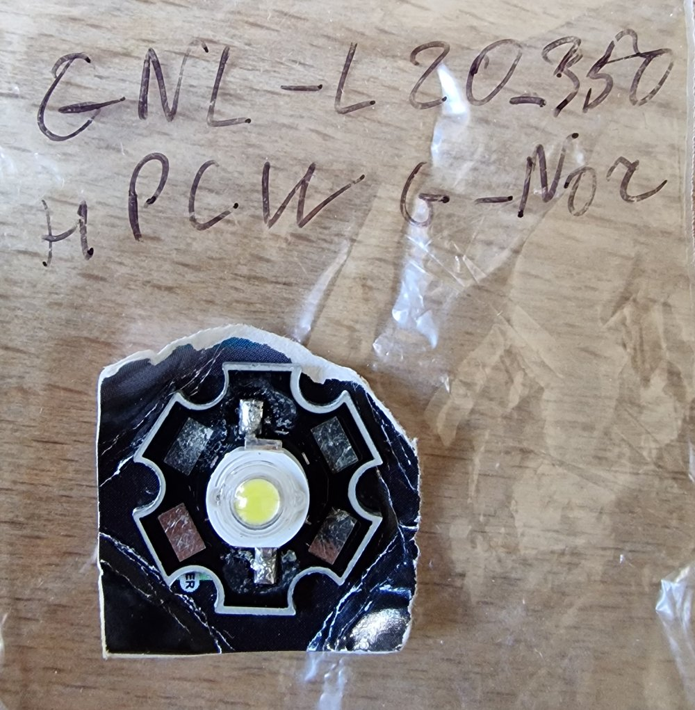

# Тіньова лампа «П'єро»

[English](README.md) · **Українська**

Нічник, який друкується на 3D-принтері й малює персонажа світлом. Сама лампа —
невисока коробочка у формі обличчя П'єро. Обличчя з чорним контуром і
підмальованими очима — це кришка, і коли лампа вимкнена, видно тільки його.
Всередині світлодіод. Коли він світить, світло проходить крізь фігурні
прорізи в стінках і малює навколо лампи решту персонажа: ковпак, волосся,
комір, тіло, дзвіночки.


Модель параметрична (OpenSCAD), а прорізи в стінці не намальовані вручну:
їх рахує скрипт із чорно-білого малюнка. Кожен промінь від світлодіода до
світлої точки малюнка на столі перетинає стінку, і в цьому місці в стінці
прорізано отвір. Тому той самий підхід працює й для іншого персонажа.

## Що вийде

- Коробочка близько **20,5 × 18 см**, разом із кришкою — близько **9 см**
  заввишки.
- Малюнок світлом на столі — приблизно **45 × 50 см**.
- Друкується без опор слайсера: де вони потрібні, вони вже є в моделі й
  потім виламуються.

| Зібрана лампа, вигляд згори | Задумана картинка | Тінь, порахована з готової стінки |
|---|---|---|
|  |  |  |

## Швидкий старт

Готових STL у репозиторії немає — їх збирають з моделі однією командою.

```sh
git clone <url-цього-репозиторію> shadow-lamp-pierrot
cd shadow-lamp-pierrot/versions/v003-print-support

python3 -m venv .venv
.venv/bin/pip install numpy opencv-python-headless trimesh

make build
```

`make build` сам бере Python з `.venv` поруч (або інший — `make build PY=…`),
рендерить усі деталі в `out/` і перевіряє їх. Наприкінці
мають бути `open edges 0` для кожної деталі (сітки замкнені) і майже
нульове `stray light` (немає світла там, де має бути тінь).

Що друкувати з `out/`:

| Файл | Деталь | Пластик |
|---|---|---|
| `pierrot_shell_print.stl` | Стінка з прорізами, разом із вбудованими опорами | Чорний матовий PLA, **непрозорий**; опори в слайсері вимкнути |
| `pierrot_ceiling.stl` | Стеля з гніздом під світлодіод | Той самий темний |
| `pierrot_lid_2color.3mf` | Кришка-обличчя у два кольори (AMS / MMU) | Білий + чорний |
| `pierrot_lid.stl` | Кришка в один колір, якщо принтер одноколірний | Білий; чорне потім зафарбувати |
| `pierrot_pins.stl` | Три штифти, що тримають кришку | Будь-який |

Після друку опори виламуються зі стінки пінцетом — їх виходить чимала купка:


Налаштування слайсера (висота шару, генератор стінок Arachne), світлодіод,
проводка й збирання описані в
[README версії v003](versions/v003-print-support/README.md).

## Залежності

**Для збирання моделі**

- [OpenSCAD](https://openscad.org/) — свіжа збірка (nightly / development
  snapshot), бо скрипт рендерить з `--backend=manifold` і `--enable=lazy-union`.
  Старий стабільний 2021.01 цих ключів не знає.
- Python 3 з пакетами `numpy`, `opencv-python-headless`, `trimesh`
  (`trimesh` потрібен лише для перевірки нависань).
- `make` і POSIX `sh` (macOS, Linux; на Windows — WSL).

**Для друку**

- Слайсер, який читає частини й нитки з 3MF: Bambu Studio або OrcaSlicer.
- Чорний непрозорий PLA для стінки й стелі. Світлий пластик пропускає
  світло, і малюнок на столі зникає.
- Білий PLA для кришки; чорний — другою ниткою, якщо друкувати її у два
  кольори.

**Для електрики**

- Світлодіод 1 Вт на платі-«зірочці» 20 мм, з широким кутом (120° і більше,
  без лінзи). Що менший кристал, то різкіша тінь.
- Живлення: у цій лампі світлодіод живиться напряму від батарейки-таблетки
  CR2032, без резистора — струм обмежує внутрішній опір самої батарейки.
  Від USB 5 В — послідовно резистор близько 10 Ом (0,5–1 Вт). В обох
  випадках два тонкі дроти.



## Як влаштований репозиторій

Кожна ітерація лампи — окрема повна тека в `versions/`, зі своєю моделлю,
скриптами, картинками й README (українською). Остання — завжди та, з якою
варто працювати.

| Версія | Що в ній |
|---|---|
| [`v001-initial`](versions/v001-initial/README.md) | Перша лампа: світлодіод на ніжці, 15 см над столом |
| [`v002-low-outline`](versions/v002-low-outline/README.md) | Удвічі нижча, рівний контур кришки, двоколірна кришка |
| [`v003-print-support`](versions/v003-print-support/README.md) | **Поточна**: вбудовані опори для стінки й перевірка нависань |

Усередині версії:

| Шлях | Що це |
|---|---|
| `pierrot_lamp.scad` | Модель; параметр `part` обирає деталь, решта — в Customizer |
| `generated/pierrot_data.scad` | Контури з малюнка: обличчя, очі, світлі ділянки (генерується) |
| `tools/make_data.py` | Генератор цих даних з малюнка |
| `tools/build.sh` | Рендер усіх деталей і перевірки (`make build`) |
| `tools/check_*.py` | Перевірки: замкненість сіток, тінь зі стінки, нависання |
| `Makefile` | `make data`, `make build`, `make sweep` |

## Свій малюнок або інша висота

Вихідного малюнка в репозиторії немає: дані з нього вже лежать у
`generated/pierrot_data.scad`, тож для `make build` він не потрібен. Щоб
перегенерувати дані — під інший масштаб, іншу висоту світлодіода чи інший
персонаж, — потрібен свій чорно-білий малюнок, де обличчя — біла зона по
центру:

```sh
cd versions/v003-print-support
make data  IMAGE=path/to/drawing.png H=80
make build
```

`H` — висота світлодіода над столом у мм. Що нижче лампа, то сильніше
стискаються на стінці далекі частини малюнка, і найдрібніші деталі вже не
друкуються. Порівняти кілька висот одразу:

```sh
make sweep IMAGE=path/to/drawing.png HEIGHTS=40,60,80
```

Масштаб задається відстанню між зіницями (для П'єро — 10 см), ключ
`--pupil-mm`. Решту ключів генератора описано в README версії.

## Про малюнок

Малюнок П'єро згенерований, але він може бути схожим на чиюсь роботу.

## Ліцензія

Код і модель OpenSCAD — під [ліцензією MIT](LICENSE). Ліцензія не
поширюється на малюнок П'єро та на контури й картинки, зроблені з нього
(див. вище).
