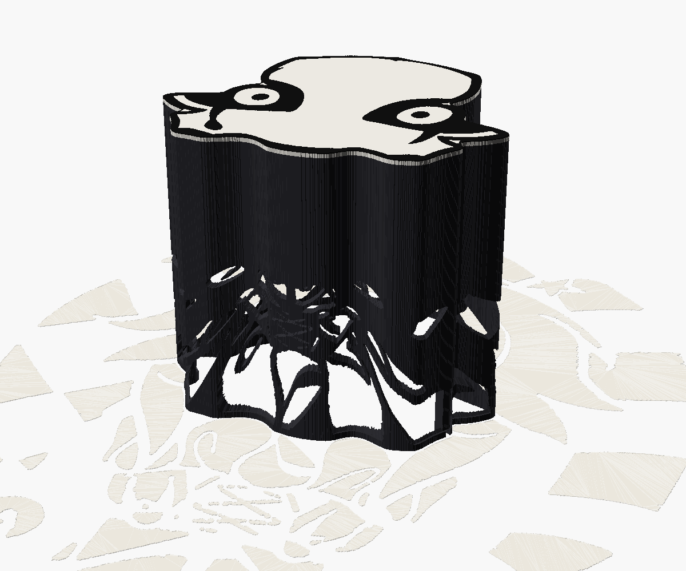
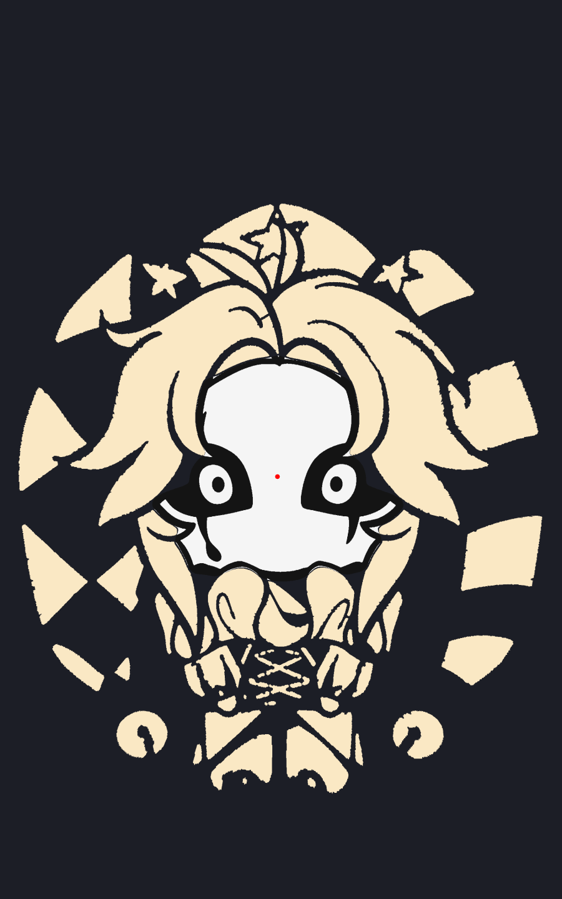
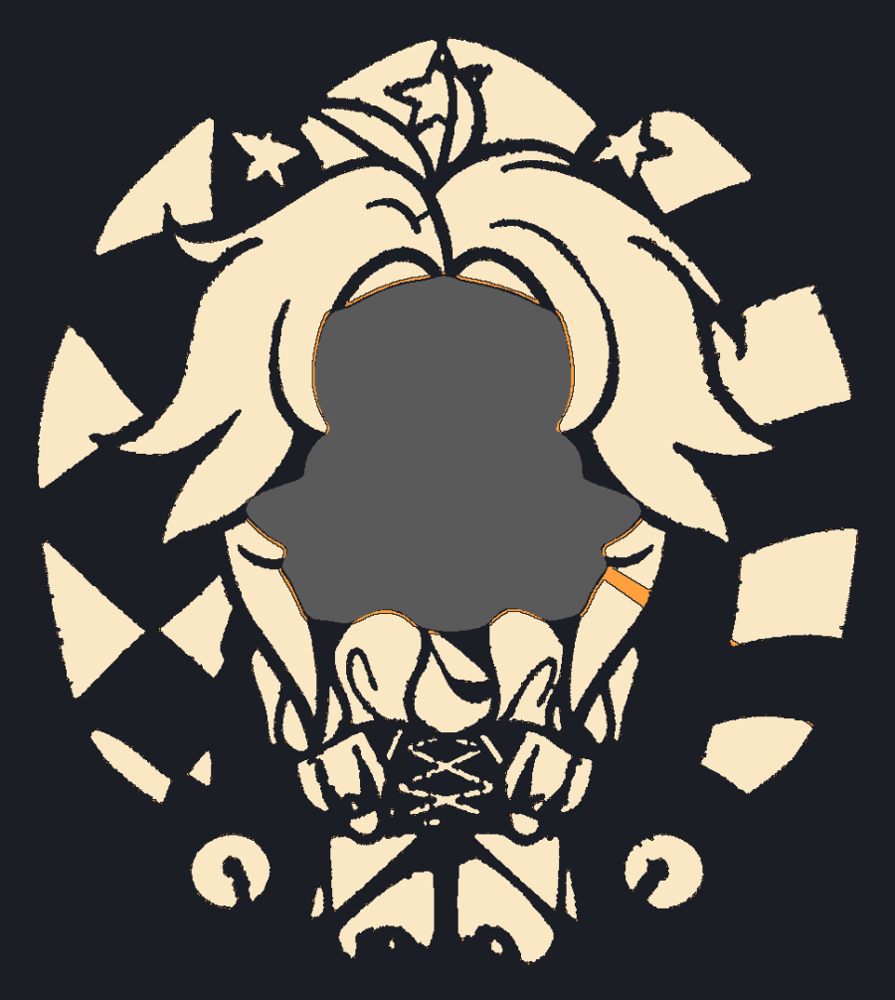
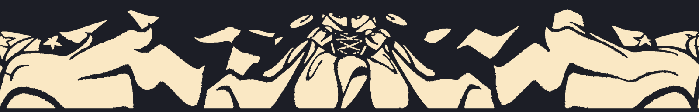

# Тіньова лампа «П'єро»

Лампа-коробочка у формі обличчя П'єро. Зверху кришка — саме обличчя з
підмальованими очима; коли лампа вимкнена, видно тільки його. Всередині, на
заданій висоті, висить світлодіод, що світить донизу й убік. Крізь фігурні
прорізи у стінках світло малює на столі решту персонажа — ковпак, волосся,
комір, тіло, дзвіночки. Вгору світло не йде: його закривають стеля й кришка.



| Задумана картинка на столі | Тінь, порахована з готової стінки |
|---|---|
|  |  |

Праворуч — тінь, яку `tools/check_shadow.py` будує з експортованого STL:
кожен трикутник стінки проєктується з точки світлодіода на стіл. Помаранчеве —
місця, які закриває конструкція (суцільна смуга біля основи та ребро з дротом).
Червоного (світла там, де має бути темно) бути не повинно.

Масштаб задано відстанню між зіницями — 10 см. З нею обличчя-коробочка має
приблизно 21 × 19 см, а малюнок на столі займає приблизно 45 × 50 см.

## Як це працює

Точка стінки на висоті `z` освітлює точку столу, віддалену від осі лампи в
`h / (h − z)` разів далі, ніж сама стінка (`h` — висота світлодіода). Тому
множина всіх «світлих» променів — це рівно
`linear_extrude(height = h, scale = 0)` від світлої ділянки столу. Модель
віднімає цей конус від стінки, і кожен проріз виходить звуженим уздовж своїх
променів.

Далекі частини малюнка (ноги, кути ковпака) лягають на стінку дуже стиснутими,
тож генератор спершу розгортає світлу ділянку на стінку, чистить її там
(тонкі перемички потовщує, надто вузькі щілини прибирає, «острівці», що
випали б, прив'язує перемичками) і переносить назад на стіл. Розгортка
стінки: світле — отвір.



## Файли

| Файл | Що це |
|---|---|
| `pierrot_lamp.scad` | Модель: всі деталі, параметри в Customizer |
| `generated/pierrot_data.scad` | Дані з малюнка: контур обличчя, очі, світлі ділянки (генерується) |
| `tools/make_data.py` | Генератор даних з `initial1.jpg` |
| `tools/build.sh` | Рендер усіх деталей в `out/` + перевірки |
| `tools/check_mesh.py` | Перевірка, що сітки замкнені |
| `tools/check_shadow.py` | Тінь з готової стінки проти задуманої картинки |

## Деталі та друк

`part` у Customizer обирає, що рендерити. Кожна деталь уже в орієнтації друку.

| `part` | Деталь | Друк |
|---|---|---|
| `shell` | Стінка з прорізами, ребро-канал для дроту, полиця під стелю | Як стоїть, основою на стіл, без підтримок. **Непрозорий** темний пластик (чорний матовий PLA) |
| `ceiling` | Стеля з ніжкою і гніздом під світлодіод | Верхньою гранню на стіл, ніжка вгору. Теж непрозорий темний |
| `lid` | Кришка-обличчя | Обличчям на стіл, білий |
| `lid_ink` | Чорні очі, сльози й обідок кришки | Разом з `lid` як друга нитка (AMS / MMU) |
| `assembly` | Уся лампа на столі з картинкою світла | Тільки для перегляду |
| `projection` | 2D: світлі ділянки + контур | Для перевірки / друку шаблону |

Без багатоколірного друку: друкуйте тільки `lid` білим — під чорне в ньому є
заглиблення, їх можна зафарбувати.

Стінка мусить бути непрозорою: світло, що просочується крізь тонкий світлий
пластик, з'їдає весь контраст. Якщо є лише світла нитка — пофарбуйте стінку
зсередини чорною фарбою.

## Світлодіод і дріт

- Чим менша світна точка, тим різкіша тінь. Найкраще — одиночний потужний
  світлодіод на круглій платі «зірочка» (типово 20 мм, параметр `led_d`).
  Не підходять COB-матриці, «кукурудза» та філаментні лампи: вони великі, і
  далекі частини малюнка розмиються.
- Плата кладеться у гніздо світлом донизу; її ставлять на клей або щільно.
  `emitter_drop` — на скільки сам кристал нижче площини плати; від нього
  залежить, де саме опиниться точка світла.
- Живлення, наприклад, від USB 5 В через резистор або драйвер струму.
  Потужність тримайте помірною: плата прилягає до пластику.
- Дріт (двожильний, до `wire_d`) іде від світлодіода вгору по ніжці, по
  канавці на верхній грані стелі, вниз по каналу в ребрі стінки й виходить
  через проріз біля основи. Ребро стоїть там, де воно затіняє найменше
  картинки (кут обирає генератор).

## Збирання

1. Пропустіть дріт через ніжку стелі, закріпіть світлодіод у гнізді.
2. Протягніть дріт по канавці стелі, вниз по каналу ребра і назовні.
3. Опустіть стелю в стінку до полиці (виріз у стелі — під ребро).
4. Покладіть кришку: штирі входять у стелю.

Найкраще лампа працює на світлій рівній поверхні в темній кімнаті; їй потрібно
місце довкола під усю картинку. Далекі частини малюнка (ноги, кути ковпака)
освітлені слабше за ближні — так поширюється світло від точкового джерела.

## Зміна масштабу чи висоти

Мех. параметри (стінка, стеля, гніздо, кришка, штирі) змінюються прямо в
`pierrot_lamp.scad`. Масштаб, висота світлодіода та мінімальні розміри
перемичок впливають на саму картинку, тож для них дані треба перегенерувати:

```sh
python3 -m venv .venv
.venv/bin/pip install -r tools/requirements.txt
.venv/bin/python tools/make_data.py --pupil-mm 100 --lamp-height 150
PY=.venv/bin/python tools/build.sh
```

Корисні ключі `make_data.py`: `--pupil-mm` (масштаб), `--lamp-height`
(висота світлодіода; вища — рівномірніше світло і більше місця для деталей на
стінці, але вища коробка), `--wall`, `--min-solid` / `--min-hole` (найтонша
перемичка і найвужчий отвір у стінці), `--pupils x1,y1,x2,y2` (якщо зіниці
не знайшлися автоматично). Якщо `lamp_height` у моделі не збігається з
даними, OpenSCAD виведе попередження.

Після генерації `tools/build.sh` має показати `open edges 0` для всіх
деталей і `stray light 0 mm2` для тіні.
