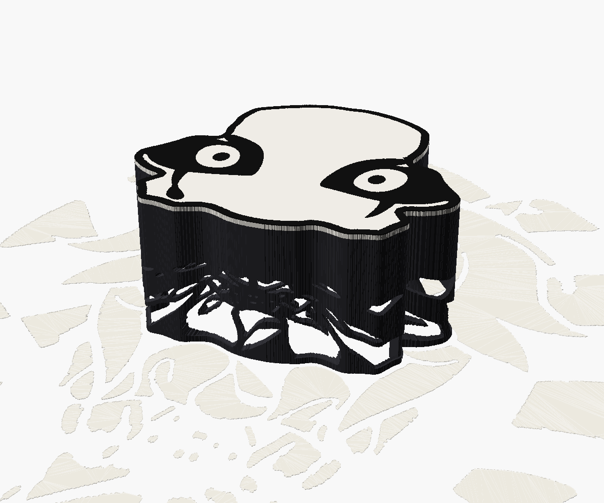

# Тіньова лампа «П'єро» — v002, низька

Лампа-коробочка у формі обличчя П'єро. Зверху кришка — саме обличчя: біле, з
рівним чорним контуром і підмальованими очима, грим яких іде вбік аж до
волосся. Коли лампа вимкнена, видно тільки його. Всередині, у стелі, світлодіод
світить донизу й убік; крізь фігурні прорізи у стінках світло малює на столі
решту персонажа — ковпак, волосся, комір, тіло, дзвіночки. Вгору світло не
йде: його закривають стеля й кришка.



| Задумана картинка на столі | Тінь, порахована з готової стінки |
|---|---|
|  |  |

Праворуч — тінь, яку `tools/check_shadow.py` будує з експортованого STL:
кожен трикутник стінки проєктується з точки світлодіода на стіл. Помаранчеве —
місця, які закриває конструкція (суцільна смуга біля основи та ребро з дротом).
Червоного (світла там, де має бути темно) бути не повинно.

Масштаб задано відстанню між зіницями — 10 см. Обличчя-коробочка має
приблизно 20,5 × 18 см, лампа разом з кришкою — близько 9 см заввишки,
малюнок на столі — приблизно 45 × 50 см.

## Що змінилось від v001

- **Удвічі нижча.** Світлодіод більше не висить на ніжці: плата вкладена в
  гніздо в нижній грані стелі, і світна точка — на 8 см над столом
  (було 15 см).
- **Рівний контур.** Край кришки — чорна лінія однакової товщини по всьому
  колу. Її ширина дорівнює типовій товщині ліній малюнка (медіана, близько
  5 мм), тож кришка й картинка на столі виглядають одним малюнком.
- **Грим очей до волосся.** Чорні тіні навколо очей ідуть ліворуч і праворуч,
  поки не впираються в пасма волосся; кришка там відповідно ширша.
- **Дроти від «зірочки».** Контакти плати на лицьовому боці, тож на краю
  гнізда є два отвори: дроти проходять повз вирізи плати на верх стелі.

## Чому саме така висота

Що нижче світлодіод, то сильніше далекі частини малюнка (ноги, дзвіночки,
шнурівка, кути ковпака) стискаються на стінці. Коли біла деталь на стінці стає
вужчою за ~1 мм, її вже не надрукуєш, і генератор її прибирає. Скільки світла
губиться на чистці для різних висот світлодіода:

| Висота світлодіода | Втрачено | Що видно |
|---|---|---|
| 40 мм | 21% | Тіло й дзвіночки розсипаються |
| 60 мм | 10% | Губляться шнурівка й частина дзвіночків |
| 80 мм | 5,6% | Ціла картинка, крім найдрібнішої шнурівки |
| 150 мм (v001) | 2,3% | Майже все |

Тонше сопло чи менші мінімальні розміри майже не допомагають: межа тут у
фізиці, а не в налаштуваннях. Нижча лампа також освітлює далекі частини
слабше: світло падає на стіл під кутом, ближчим до горизонту. Тому важливо
брати світлодіод з широким кутом (120° і більше, без лінзи-коліматора).

## Файли

| Файл | Що це |
|---|---|
| `pierrot_lamp.scad` | Модель: всі деталі, параметри в Customizer |
| `generated/pierrot_data.scad` | Дані з малюнка: контур обличчя, очі, світлі ділянки (генерується) |
| `tools/make_data.py` | Генератор даних з `initial1.jpg` у корені проєкту |
| `tools/build.sh` | Рендер усіх деталей в `out/` + перевірки |
| `tools/check_mesh.py` | Перевірка, що сітки замкнені |
| `tools/check_shadow.py` | Тінь з готової стінки проти задуманої картинки |
| `tools/lid_3mf.py` | Двоколірна кришка: один об'єкт з двома частинами, нитки 1 і 2 |

## Деталі та друк

`part` у Customizer обирає, що рендерити. Кожна деталь уже в орієнтації друку.

| `part` | Деталь | Друк |
|---|---|---|
| `shell` | Стінка з прорізами, ребро-канал для дроту, полиця під стелю | Як стоїть, основою на стіл, без підтримок. **Непрозорий** темний пластик (чорний матовий PLA) |
| `ceiling` | Стеля з гніздом під світлодіод і канавками під дроти | Верхньою гранню на стіл. Теж непрозорий темний |
| `lid` | Кришка-обличчя, знизу гнізда під штифти | Обличчям на стіл, білий. Знизу рівна, тож друкується й навпаки — підтримки не треба в жодному разі |
| `lid_ink` | Чорні контур, очі й сльози | Разом з `lid` як друга нитка (AMS / MMU) |
| `lid_2color` | Кришка й чорна вставка разом, один 3MF | Див. «Двоколірна кришка» нижче |
| `pins` | Три штифти-фіксатори | Стоячи, будь-яким пластиком. Можна замінити шматками прутка того ж діаметра (`pin_d`) |
| `assembly` | Уся лампа на столі з картинкою світла | Тільки для перегляду |
| `projection` | 2D: світлі ділянки + контур | Для перевірки / друку шаблону |

### Двоколірна кришка

Чорне — це вставка на верхні шари кришки, тож кольорів міняти доводиться лише
на кількох перших шарах (кришка друкується обличчям донизу). `tools/build.sh`
кладе кришку у файл `out/pierrot_lid_2color.3mf`: один об'єкт `pierrot_lid`
з двома частинами на своїх місцях — «lid (white)» на нитці 1 і «ink (black)»
на нитці 2. Налаштувань принтера й ниток у файлі немає, тож він не змінює
налаштувань слайсера.

Як він складається (те саме робить `build.sh`):

```sh
openscad --enable=lazy-union -O export-3mf/add-meta-data=false \
    -D 'part="lid_2color"' -o out/pierrot_lid_2color.3mf pierrot_lamp.scad
python3 tools/lid_3mf.py out/pierrot_lid_2color.3mf
```

OpenSCAD записує дві частини як два окремі тіла (без `--enable=lazy-union` він
зливає їх в одне, і межа між кольорами зникає). `tools/lid_3mf.py` збирає їх в
один об'єкт і дописує призначення ниток у `Metadata/model_settings.config` —
той файл, який читають Bambu Studio та OrcaSlicer.

У Bambu Studio:

1. Відкрийте 3MF. Повідомлення «The 3mf file has invalid config, load geometry
   data only» — нормальне для 3MF, створеного не в Bambu: файл навмисно не
   несе налаштувань принтера. Натисніть OK.
2. Поставте в слоти AMS білу нитку першою, чорну другою (або перепризначте
   частини в списку об'єктів).

Те саме можна зробити з двох STL (`pierrot_lid.stl` + `pierrot_lid_ink.stl`):
імпортувати разом як один об'єкт з двома частинами — координати в них спільні.

Без багатоколірного принтера: друкуйте тільки `lid` білим. Під чорне в ньому є
заглиблення, їх можна зафарбувати. Зміна нитки на певній висоті тут не
допоможе: чорне й біле лежать в одних і тих самих шарах.

Стінка мусить бути непрозорою: світло, що просочується крізь тонкий світлий
пластик, з'їдає весь контраст.

## Світлодіод і дріт

- Одиночний світлодіод 1 Вт на платі «зірочка» 20 мм (`led_d`), з куполом
  без лінзи. Чим менший кристал, тим різкіша тінь.
- Виміряйте, на скільки кристал нижче площини плати, і задайте `emitter_drop`.
- Живлення, наприклад, від USB 5 В через резистор близько 10 Ом (0,5–1 Вт),
  це приблизно 200 мА. На повну потужність не ганяйте: плата прилягає до
  пластику.
- Дроти припаюються до контактів на лицьовому боці, проходять через вирізи на
  краю плати в отвори на краю гнізда, по канавці на верхній грані стелі — до
  ребра, вниз по каналу в ребрі й назовні через проріз біля основи.

## Збирання

1. Припаяйте дроти, протягніть їх через отвори на краю гнізда й вкладіть
   плату в гніздо світлом донизу (на клей або щільно).
2. Покладіть дроти в канавку стелі й протягніть вниз по каналу ребра назовні.
3. Опустіть стелю в стінку до полиці (виріз у стелі — під ребро).
4. Вклейте штифти в гнізда на верхній грані стелі (довшим кінцем униз).
   Вони виступають трохи менше, ніж глибина гнізд у кришці, тож кришка
   лежить на стелі, а не на штифтах.
5. Покладіть кришку: вона просто надівається на штифти й знімається.

## Зміна масштабу чи висоти

Механічні параметри (стінка, стеля, гніздо, кришка, штифти, ширина контуру
`ink_rim`) змінюються прямо в `pierrot_lamp.scad`. Масштаб, висота світлодіода
та мінімальні розміри перемичок впливають на саму картинку, тож для них дані
треба перегенерувати (з теки цієї версії):

```sh
python3 -m venv .venv
.venv/bin/pip install -r tools/requirements.txt
.venv/bin/python tools/make_data.py --lamp-height 80
PY=.venv/bin/python tools/build.sh
```

Корисні ключі `make_data.py`: `--pupil-mm` (масштаб), `--lamp-height`,
`--rim` (ширина контуру кришки, мм; без нього — товщина ліній малюнка),
`--lid-neck` (наскільки широкий чорний проміжок між пасмами ще вважається
гримом), `--min-solid` / `--min-hole`, `--pupils x1,y1,x2,y2` (якщо зіниці
не знайшлися автоматично). Якщо `lamp_height` у моделі не збігається з
даними, OpenSCAD виведе попередження.

Після генерації `tools/build.sh` має показати `open edges 0` для всіх
деталей і майже нульове `stray light` для тіні.
